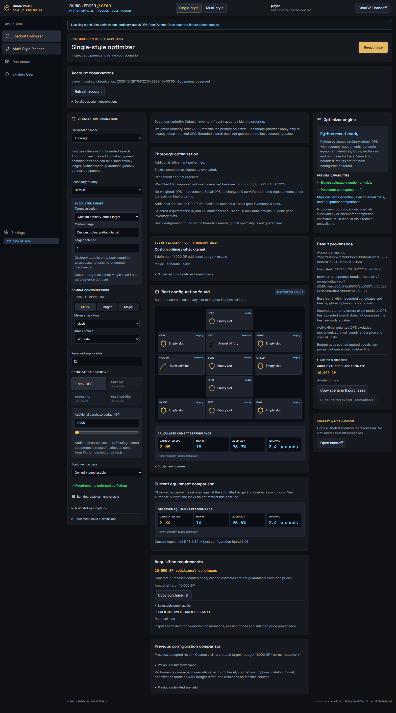
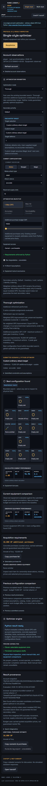

# Fast and Thorough gear optimization

## Deployment decision

**Development integration only; production Thorough remains disabled by leaving production unchanged.** No production `/gear` replacement, Docker packaging change, deployment or Milestone 6 cutover is authorized or performed. A user-accepted latency/resource envelope is still required before deployment. Benchmark observations alone do not constitute that acceptance.

Fast is the default for existing and new browser requests. It runs the existing bounded optimizer. Thorough explicitly opts into the existing `local_refinement` after that same search, with at most 2,000 additional complete assignment checks. Both report **Best configuration found** (`best_found`), never a global optimum. Thorough does not enable `targeted_head_refinement`.

The existing complete validator and final ordering govern every accepted replacement. Original valid incumbents are preserved in refinement diagnostics. Combat formulas, candidate pools, beam widths, pruning and final scoring are unchanged. Reaching the refinement cap is a normal bounded-search outcome, not an optimization failure.

## Running attack costs

Scenarios containing Magic also calculate a separate best-found frontier comparing
DPS with running GP per damage, alongside the selected secondary priority. Mixed
Multi scenarios include all active roles; Auto compares the allowed disciplines.
Equipment purchase costs remain separate and the equipment budget is unchanged.

Standard spell recipes subtract runes supplied by the equipped staff before
pricing remaining runes from the frozen cached price snapshot. Result details
identify the supplied runes and their source. Owned runes retain replacement value.
Costs apply to attack attempts, including misses. GP/hour assumes continuous
attacks; GP/damage divides running GP/second by expected DPS. Multi uses the ratio
of weighted consumption and damage rates, rather than averaging efficiency ratios.

Ranged comparisons include reviewed ammunition consumption and automatic recovery;
manual ground collection is excluded. Ordinary nondegrading melee has no attack
resource cost. Missing prices and unreviewed charge/consumption mechanics are
unavailable, never free. Cost recipes do not enable unsupported combat mechanics.
Potions, prayer supplies, loot and combat downtime are excluded.

The additive `running_cost` summaries and `running_cost_frontiers` use a separate
bounded work policy. Selecting a cost point selects its equipment and combat
options. The existing DPS-loss limit applies, with at most 64 displayed points per
group and endpoints retained. An unknown-cost DPS baseline remains visible without
participating in numerical cost dominance. Refresh market prices before comparing
costs; cached observations retain their provenance labels.

## Contract and identity

The browser endpoint remains `POST /ui-api/gear/optimizations`. `optimization_mode` is separate from the existing equipment-access `mode` (`owned`, `usable`, `future`). Omitted `optimization_mode` means `fast`; its only accepted explicit values are `fast` and `thorough`. Unknown values, nulls and other types are rejected with structured 422 validation errors.

The effective `work_budget_policy` is server-owned. Fast returns `{ "policy": "baseline-v1", "complete_assignment_limit": 0, "targeted_head_refinement": false }`; Thorough returns `{ "policy": "local-refinement-v1", "complete_assignment_limit": 2000, "targeted_head_refinement": false }`. Both the response envelope and `result` identify `optimization_mode` and this policy. The scenario fingerprint hashes the normalized scenario together with the effective policy, including for fixed-loadout trial evaluations against that scenario. Clients cannot supply their own policy or cap.

Mode and effective policy participate in request/result identity so a Fast response cannot satisfy a Thorough submission. Snapshot, catalog, numerical model, normalized scenario, assumptions and frozen price provenance remain part of result validation. Mode or policy changes invalidate accepted-result compatibility and previous-result comparisons. Historical Fast-only response metadata may be absent for compatibility; Thorough responses must explicitly identify their mode and effective policy.

See [the browser API contract](GEAR_BROWSER_API.md) for exact transport fields and existing error responses. Worker-thread execution, the service busy guard, pre/post account fingerprint checks, cooperative cancellation and same-origin protections are retained. There are no background queues, persistent jobs or stored results.

## React behavior

### Automatic discipline selection

Single mode offers opt-in **Auto** beside the three manual disciplines. Existing
and new drafts keep their manual defaults. Auto initially considers melee, ranged,
and magic; users can exclude disciplines but must leave at least one selected.
Attack-type, stance, and spell optimization stays enabled in Auto, with eligibility
and explicit option exclusions taken from the existing account capabilities.
Manual settings are retained when switching back. Single and Multi drafts remain
separate, and Multi continues to require explicit disciplines.

Each allowed discipline receives a complete existing Fast or Thorough search over
the same frozen inputs. This preserves manual search effort per discipline and can
take roughly three manual runs when all are enabled. Results identify the selected
discipline and compare each permitted discipline's best-found DPS and purchase cost,
including reasons when a branch finds no feasible setup. Cancellation discards the
whole operation rather than presenting an incomplete comparison as a winner.
The server-owned work policy reports `budget_scope: "per_discipline"` and the
effective `discipline_count`; Thorough's 2,000-assignment limit applies per branch.

The existing DPS-first ordering selects the winner. Secondary frontiers combine
discipline candidates before applying the shared DPS-loss threshold; curve and
frontier selections retain their own resolved discipline and combat option. Item
inspection and exact manual trials use those selections. An Auto fixed-loadout
comparison without a pinned option chooses the best legal permitted option for
that equipment. Neither Auto nor a branch without a result proves optimality or
infeasibility. This addition makes no production deployment or latency-acceptance
claim. See the browser API contract for request and diagnostic fields.

### Secondary priority

Both modes accept `secondary_priority`, defaulting to `default` (the existing inventory/cost/action/identity ordering). The configuration dropdown also offers Balanced defence, individual Stab/Slash/Crush/Ranged/Magic defence, Prayer bonus, Melee strength bonus, Ranged strength bonus, Magic damage bonus and Accuracy. All options remain available for one to four roles.

Weighted ordinary-attack DPS remains the primary objective. A priority is maximized only when modeled DPS compares exactly equal under the existing float ordering; there is no tolerance or rounded-DPS comparison. Remaining ties use the existing ordering. Candidate retention and partial beams use the selected priority after their DPS estimate, while preserving the existing Fast/Thorough work limits and complete legality checks. Bounded search does not guarantee the best secondary value, or a global DPS optimum.

Metrics come from Python equipment bonuses and combat evaluation. Balanced defence is the arithmetic mean of the five equipment defence bonuses, not a survival estimate. Individual defence, prayer, melee/ranged strength and magic damage use their corresponding equipment bonuses; magic damage is measured in percentage points. Accuracy is the evaluator's hit probability against each role's configured target. Across scored roles, metrics use the same normalized active-time weights as primary DPS; unscored utility roles contribute nothing. Results show the selected priority and measured value separately from DPS (`null` for Default, which has no single numeric metric).

The normalized scenario, its fingerprint, result provenance and every solution carry the selected priority. Switching it makes accepted results outdated and prevents incompatible result/trial comparisons. Omitted and explicit Default requests normalize identically. No combat formulas, catalog rules, search budgets or deployment settings change.

Focused regression entry points are `tests/gear/test_secondary_priorities.py`, `tests/api/test_gear_secondary_priorities.py` and `frontend/gear/src/tests/secondary-priorities.test.tsx`.

The Runic Ledger configuration panel includes a compact Fast/Thorough selector. Fast uses the existing bounded search; Thorough searches additional equipment combinations and can take substantially longer. Neither guarantees globally optimal equipment. The selection belongs to the draft. Changing it marks an accepted result outdated while retaining that result for inspection. Single and Multi workspaces, item inspection, locks/exclusions and manual trials retain their existing state boundaries.

Results identify the submitted mode. Thorough diagnostics show whether additional work ran, extra complete assignment attempts, cap status and the selected solution's actual weighted-DPS difference from its preserved baseline. Equal-DPS ordering changes are distinguished from damage improvements. Acquisition GP, equipment actions and peak gear inventory differences are compared against that same baseline. Diagnostics for a selected curve point use its corresponding original curve point. The API also preserves the unrestricted baseline; this milestone adds no separate unrestricted equipment view.

Progress remains indeterminate. The synchronous HTTP contract provides no reliable live refinement-phase telemetry or completion estimate. Cancellation signals the existing cooperative callback; the worker holds the busy guard until it exits. No percentage is inferred from the assignment cap.

Browser screenshots use a disposable seeded database and the real Python API with a deliberately small bundled catalog. They demonstrate UI behavior, not real-account search quality or Pi acceptance:





## Historical callers

Historical browser requests omit the new field and continue using Fast. The normalized browser response gains mode/policy metadata and its identity changes accordingly; optimizer numbers and baseline search semantics remain unchanged. NiceGUI and RuneLite workflows are preserved.

The MCP `optimize_gear` tool continues to accept the existing domain `OptimizationRequest` and invoke the service default. There is no concrete MCP mode-selection use case or compatibility justification in this milestone, so its public schema is not expanded for parity. Existing direct Python opt-in refinement remains available.

Fixture and live adapters remain separate. Fixture data is demonstration data and is not evidence of Python optimization quality or live account state. Draft persistence remains separated by adapter/account; results and trials remain session-only.

## Verification and operational acceptance

The new [portable expanded Slash fixture](../tests/fixtures/gear_expanded_slash_account.json) contains 124 supported eligible equipment definitions, 88 owned physical IDs and seven requirement quests. It contains no account name, XP, private database or unrelated observations. Its SHA-256 is `a283aeea2ea04d61c21d5401767d8e74c7a3fb167a4560cf1d49903e95b89aa0`. The historical fixture remains unchanged (`402bbed7834ffe0f4e069f253f24d999f691b41ec7846879a9aa10db7460a46d`). These are frozen regression inputs, not fresh observations.

The expanded fixture reproduces Fast Slash at **2.6708655667374095 DPS**, Warrior helm `3753`. Replacing only the head with owned Berserker helm `3751` passes the complete validator and produces **2.7955325803150433 DPS**, zero additional GP, max hit 18 rather than 17. Thorough recovers at least that objective value; its final tie-selected equipment need not be the exact Berserker witness.

Focused regression runs:

| Check | Result |
| --- | --- |
| Browser API optimization/joint/evaluation/read/service coverage run, then final mode/legacy service append | 144 + 20 passed; 94% scoped coverage |
| React tests | 172 passed; 90.32% line coverage, 86.24% branch coverage |
| Desktop/mobile browser acceptance | 18 passed |
| New expanded Slash, historical owned/+1M/+5M/joint recovery, complete 1–4-role curve replay | 9 passed |
| Existing local refinement, integration and historical trace selection | 52 passed |
| Retained MCP optimizer and UI preview/optimizer compatibility | 17 passed |
| Isolated API benchmark workloads, static manifest, cancellation evidence and environment isolation | 13 passed |

The complete-curve checks preserve every configured role and required transition, replay equipment legality, acquisition/budget and inventory constraints, compare every feasible refined point against its original final ordering and verify the original candidate/search work remains unchanged. Existing finite fixtures retain independent exhaustive-oracle coverage. These counts describe separate focused runs; overlapping core checks are not added into a unique test total.

Browser optimization and fixed-evaluation modules each reached 97% coverage; the shared gear service reached 90%. API checks include omitted/explicit Fast parity, strict invalid modes, forged-policy rejection, Thorough original incumbents/diagnostics, all role counts, cooperative cancellation, busy handling, pre/post stale-account rejection and matching fixed-trial identity. Scoped Ruff, mypy and diff checks passed. An independent review found no blocking correctness/security findings and independently reran 19 API mode tests and 54 React mode/optimization/refinement-state tests.

React coverage was 89.93% statements, 86.24% branches, 91.23% functions and 90.32% lines. New mode identity code reached 100% lines/93.02% branches; the mode summary reached 100% lines/89.74% branches. TypeScript and the production frontend build passed. Browser checks covered Fast defaults, Thorough submission, outdated accepted results, retained draft mode, blocked incompatible comparisons, joint two/three/four-role requests, optimization, exact manual trials, constraints, fixture workflows and retained Gear/dashboard/API boundaries. Screenshots above were visually inspected; these automated local browser checks do not claim physical RuneLite gameplay acceptance.

The final desktop/mobile mode checks were rerun after adding an exact manual trial against a Thorough result. Both passed, including matching scenario fingerprints, rendered comparison and revert. Frontend formatting and scoped whitespace checks passed.

Reproduce the new regression cases with `.venv/Scripts/python.exe -m pytest tests/gear/test_optimization_mode_regressions.py -q`. API/browser verification and Pi serving-process measurements follow below. Existing isolated compute measurements in [the enablement review](GEAR_REFINEMENT_ENABLEMENT_REVIEW.md) remain historical evidence; they do not measure serving-interpreter contention.

Focused entry points:

```powershell
.venv/Scripts/python.exe -m pytest tests/api/test_gear_optimization_modes.py tests/gear/test_optimization_mode_regressions.py tests/tools/test_benchmark_gear_modes_api.py -q
cd frontend/gear
npm run test:coverage
npm run build
npm run test:e2e -- modes.spec.ts joint.spec.ts optimization.spec.ts refinement.spec.ts workflows.spec.ts
```

## Pi serving-process performance gate

**No new Pi API timings are claimed.** Read-only SSH confirmed the existing Pi was reachable (`aarch64`). Automatic approval review rejected both the initial broad staging archive and a materially narrower reviewed 28-file static allowlist. The stated remaining reason was that source-code transfer to the Pi needed explicit approval of the payload and destination. Neither rejected command ran a benchmark. Approval has been requested for the restricted transfer; it is not inferred from elapsed time.

The [isolated API benchmark](../tools/benchmark_gear_modes_api.py) prepares real Fast/Thorough HTTP requests for one-role Slash, Ranged and Magic and joint two/three/four-role configurations. It uses a fresh synthetic database, normal `create_app` worker-thread execution and the actual service guard, with concurrent dashboard/context/sync probes and a disposable MCP sidecar. It binds only loopback and removes temporary services/data. It changes no production routing, installed source or live account observations. Its workloads and explicit static transfer manifest have focused tests. Synthetic inputs and copied installed dependencies must be identified in any eventual measurements; these do not establish current-account gameplay acceptance.

The [performance acceptance report](GEAR_OPTIMIZATION_MODES_PERFORMANCE.md) records the workload matrix, proposed command, measurement boundaries, transfer contents and outstanding acceptance table. Its local harness tests do not establish successful Pi execution.

Wall/CPU time, container/host memory, cancellation responsiveness, dashboard latency, RuneLite sync latency and MCP responsiveness are **unmeasured for this implementation on Pi**. No user-accepted latency/resource envelope exists. Do not deploy Thorough until the isolated serving-process matrix has run, the results and limitations have been reviewed, and the user has accepted an envelope. Historical lower-priority separate-process compute benchmarks cannot substitute for this gate.

## Known limitations

Search remains bounded and candidate-limited. Thorough improves only what the existing additional search visits and does not prove optimality or infeasibility. Unsupported combat mechanics remain unsupported. Cancellation is cooperative and may wait for an optimizer checkpoint, including candidate preparation. No reliable completion estimate is available. Production readiness additionally requires explicit acceptance of serving latency, resource use and concurrent dashboard, RuneLite sync and MCP behavior.

### Browsing Auto disciplines

Single Auto results open on **Auto overall**. Tabs for each searched discipline expose its best-found loadout and its own secondary tradeoff frontier, including disciplines dominated in the combined frontier. Default priority shows each discipline's best DPS loadout; select a named secondary priority to explore tradeoffs. Discipline DPS loss is measured from that discipline's best DPS under the same swap limit. Frontiers remain bounded best-found results and may be sampled to 64 points, preserving endpoints.

The additive `result.discipline_results` list retains each searched discipline's status, reasons, selected solution, secondary frontiers, search diagnostics, limitations, and contextual alternatives. Existing overall fields retain their meaning. Switching tabs does not run another search or change the overall Auto winner.
