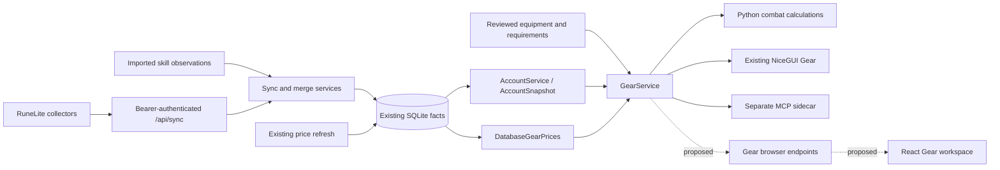
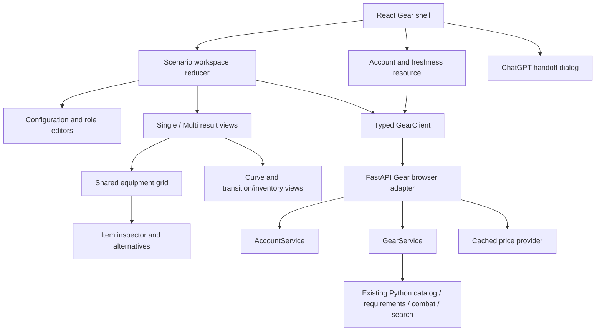
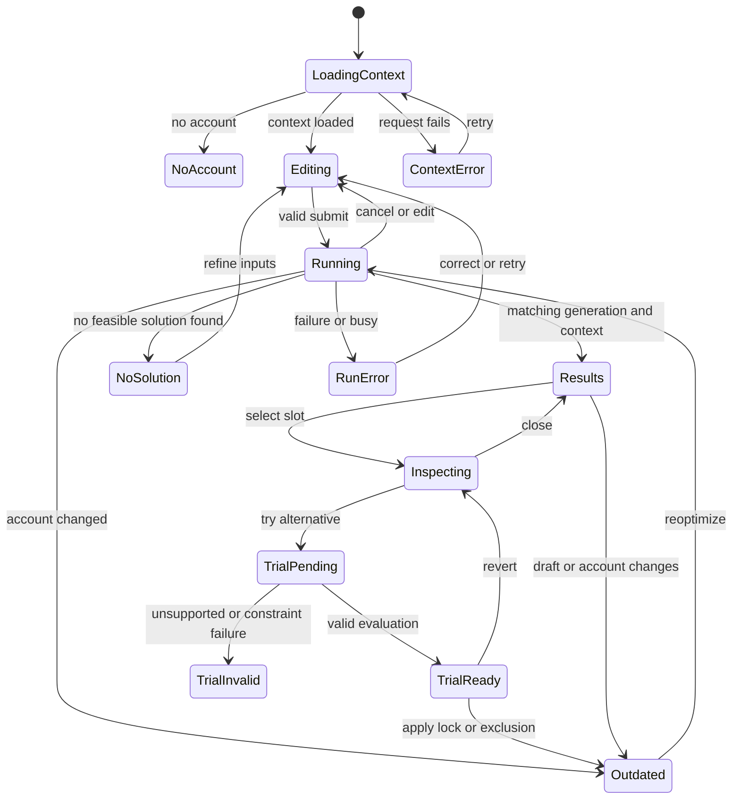

# Gear Optimizer Redesign Assessment and Implementation Plan

**Assessment date:** October 22, 2026  
**Repository:** branch `main`, commit `61695516e6055374cba2f07dbc9a2a705bd29335`

**Document status:** Assessment completed and report saved. No production source files were changed, dependencies installed, database migrations applied, or commits created. Implementation requires a separate instruction.

## 1. Executive summary

### Recommended architecture

Build a dedicated React Gear interface served by the existing FastAPI application. Retain NiceGUI for the rest of the dashboard.

The existing dashboard uses **NiceGUI, not Streamlit**. FastAPI already hosts the application, so adding a Gear-specific JSON interface and serving compiled React assets requires no additional production service.

### Current backend readiness

The repository already contains a deterministic, account-aware equipment optimizer with:

- Single-role and joint multi-role search.
- Skill and quest eligibility checks.
- Global and role-specific equipment locks.
- Owned-only, purchasable, and hypothetical modes.
- Additional purchase budgets with shared purchases counted once.
- Directional equipment actions and inventory-capacity checks.
- A selectable swap-efficiency curve.
- Contextual single-role alternatives.
- Account, catalog, calculation, ownership, and partial price provenance.

Important gaps are HTTP exposure, exact manual equipment evaluation, item exclusions, complete price provenance in physical-item responses, and production frontend contracts.

The combat model supports a limited subset of ordinary attacks. It does not support prayers, potions, scored special attacks, defensive optimization, full encounter simulation, or the prototype’s survivability claims.

### Prototype reuse

Reuse the dark palette, typography, card treatments, equipment layout, information hierarchy, and single/multi comparison patterns.

Refactor the five screens into shared components driven by one state model. Replace mock calculations, screen-navigation simulations, fabricated explanations, hardcoded exports, and simulated ChatGPT replies.

### Implementation sequence

1. Build the reusable React workspace using typed deterministic fixtures.
2. Connect authoritative account, equipment, item, and freshness information.
3. Expose real single-style optimization and current-equipment comparisons.
4. Add manual evaluations, exclusions, and refinement.
5. Integrate the existing joint optimizer and exact transition model.
6. Replace the Gear entry point and verify packaging and deployment.

### Decisions confirmed during assessment

- React Gear will run on the existing server.
- Initial optimization will support DPS only; other objectives remain unavailable.
- Gear browser endpoints will follow the existing dashboard’s private network access boundary.
- Existing `/api/*` bearer authentication, including RuneLite sync, remains intact.

### Major risks

The largest risks are limited reviewed equipment coverage, overstating bounded search quality, confusing equipment actions with changed slots, reconstructing equipment from container observations, and preserving provenance across comparisons.

**Recommended first implementation task:** build the fixture-backed React foundation at a preview route, with shared components and state, while leaving `/gear` operational.

## 2. Current architecture inventory

### Repository state and assessment boundary

At the start of assessment, the working tree contained only the pre-existing untracked `docs/ui/` directory. There were no tracked modifications.

The supplied archive was inspected and extracted under `/tmp` for assessment. Its SHA-256 is:

```text
c7bace663b7cebe9ee17783c83add4c16dd965ab1c37f15f9aadfca9ef5ffb54
```

No live account database inspection was needed. Account conclusions below describe source behavior and deterministic tests, rather than the current player’s equipment.

Source line references describe the assessed commit. Relative links are portable within the repository; the labels identify the relevant starting lines.

### Subsystem inventory

| Subsystem | Implementation, inputs, outputs, and dependencies | Validation and limitations | Disposition |
|---|---|---|---|
| Application startup | [`tracker/app.py:26`](../tracker/app.py), `create_app`; loads settings/content, injects SQLAlchemy sessions, mounts UI, optionally attaches refresh scheduler. `main` starts Uvicorn. | `tests/test_app.py`; UI mounting uses NiceGUI global registration. | Reuse; register Gear routes/assets before NiceGUI’s root mount. |
| Dashboard and navigation | [`tracker/ui/pages.py:35`](../tracker/ui/pages.py), `register_pages`; [`tracker/ui/shell.py:58`](../tracker/ui/shell.py), `NAV`. Routes include dashboard, Gear, skills, unlocks, settings. | Factual-view tests and browser journeys. No Streamlit dependency or dashboard implementation was found. | Retain unrelated NiceGUI pages. |
| Existing Gear UI | [`tracker/ui/pages.py:105`](../tracker/ui/pages.py) supplies snapshots, cached prices, and time to [`tracker/ui/gear.py:176`](../tracker/ui/gear.py), `render_optimizer`. Includes presets, role configuration, future assumptions, locks, curves, catalog browsing, and cancellation. | `tests/ui/test_optimizer_ui.py`; `tests/ui/test_pages_browser.py`. Rendering and interaction state are NiceGUI-specific. | Replace incrementally after React parity. |
| Gear presentation | [`tracker/ui/gear_presentation.py:240`](../tracker/ui/gear_presentation.py), `render_solution`; renders equipment, calculated metrics, inventory, actions, alternatives, and local sprites. | Tests distinguish strength bonuses, alternative context, and automatic removals. | Reuse behavioral requirements and assets; replace rendering. |
| Shared Gear service | [`tracker/gear/service.py:38`](../tracker/gear/service.py), `GearService`; receives immutable snapshots and injected prices/time. Exposes optimization, physical catalog browsing, legacy progression, item details, and legacy changes. | `tests/gear/test_optimizer_service.py`, `tests/gear/test_service.py`. Concurrency lock is per service instance. Module introduction describes legacy functionality and is incomplete as an architectural description. | Extend; maintain one service instance for main-app Gear consumers. |
| Legacy curated progression | [`tracker/gear/ladders.py:24`](../tracker/gear/ladders.py), `build_ladders`; groups authored content by style/slot and editorial tier. `GearService.progression`, `candidates`, and `evaluate_change` expose factual compatibility operations. | Legacy item-change results explicitly do not validate joint loadouts or calculate combat deltas. | Exclude from new optimizer UI; retain MCP compatibility operations. |
| Equipment optimizer | [`tracker/gear/optimizer.py:552`](../tracker/gear/optimizer.py), `optimize`; frozen snapshot/request/catalog/prices/time → selected solution, curve, alternatives, facts, assumptions, diagnostics. | Optimizer, fingerprint, facts, and service tests. Search is bounded and cannot prove global optimality or general infeasibility. | Reuse; add narrowly scoped validation/evaluation extensions. |
| Combat calculations | [`tracker/gear/combat.py:54`](../tracker/gear/combat.py), `evaluate_loadout`; physical definitions, role, levels, target → `CombatPerformance`. | Independent arithmetic tests and pinned reference fixtures. Supported ordinary attacks only. | Preserve in Python. |
| Physical item catalog | [`tracker/gear/catalog.py:48`](../tracker/gear/catalog.py), `load_catalog`; checksum-verified statistics plus authored requirement/acquisition overlays → immutable physical definitions. [`tracker/gear/models.py:34`](../tracker/gear/models.py) defines equipment metadata. | Catalog and bonus-pipeline tests. Most imported equipment lacks reviewed eligibility or effects coverage. | Reuse; expose coverage honestly. |
| Account boundary | [`tracker/accounts/service.py:16`](../tracker/accounts/service.py), `AccountService.get_snapshot`; transactional reads → [`AccountSnapshot:39`](../tracker/accounts/snapshot.py), with immutable observations and cached fingerprint. | Item-snapshot and fingerprint tests. Summary excludes item/container details, which must be projected separately. | Authoritative account read boundary. |
| Requirements | [`tracker/accounts/requirements.py:70`](../tracker/accounts/requirements.py), `evaluate_requirement`; snapshot and requirement tree → satisfied/unsatisfied/unknown with reasons. | `tests/quest_cape/test_service.py`, Gear facts/service tests. Unknown metadata is conservative; timestamps do not automatically expire eligibility. | Reuse everywhere. |
| RuneLite synchronization | Plugin [`ContainerObserver.java:37`](../plugin/src/main/java/com/osrstracker/plugin/collect/ContainerObserver.java) observes containers. [`tracker/api/sync.py:98`](../tracker/api/sync.py) validates payloads; [`tracker/sync/pipeline.py:67`](../tracker/sync/pipeline.py) merges observations and refreshes scoped prices. | Python contract/sync tests and existing Java collector tests. No frontend should generate replacement observations. | Preserve. |
| Ownership and observations | [`tracker/gear/facts.py:17`](../tracker/gear/facts.py), `observed_ownership`; dated concrete sightings and scan coverage → owned/unowned/unknown. [`tracker/db/models.py:158`](../tracker/db/models.py) stores latest item sightings. | Superseded-sighting and asynchronous-quantity tests. Item sightings are latest rows, not a complete historical inventory ledger. | Reuse exact semantics. |
| GE prices | [`tracker/db/gear_prices.py:27`](../tracker/db/gear_prices.py), `DatabaseGearPrices`; cached rows → immutable price records. [`tracker/estimation/prices.py:125`](../tracker/estimation/prices.py), `resolve_price`; records/content/time → selected acquisition quote and provenance. | Pricing, freshness, cache, bulk, attribution, and service tests. Optimization performs no network refresh. | Reuse; enrich physical-item provenance. |
| MCP | [`tracker/mcp/server.py:124`](../tracker/mcp/server.py), `build_server`; nine read-only tools. `optimize_gear` delegates to GearService in a worker. [`tracker/mcp/__main__.py:17`](../tracker/mcp/__main__.py) builds a separate configured-account process. | Optimizer and legacy MCP delegation tests. Exact `/mcp` listener intentionally excludes dashboard/sync routes. | Preserve; React does not communicate through MCP. |
| Persistence | [`tracker/db/session.py:32`](../tracker/db/session.py), engine/session factories; SQLAlchemy, SQLite WAL, Alembic. Account observations, prices, sync audit persist; computed optimizations do not. | Repository, migration, and session tests. Historical recommendation tables were already retired by a migration. | Reuse without schema changes. |
| Deployment | [`Dockerfile:1`](../Dockerfile), entrypoint, Makefile, container workflow. Python image serves one application port; MCP uses a separate process/image command. | Existing container smoke and packaging checks. Current image has no React build stage. | Extend build packaging; retain runtime topology. |

### Important distinctions

**Curated progression is not optimization.** Editorial ladder order does not measure combat performance. The physical optimizer calculates complete configurations independently of ladder ranking.

**Authored metadata remains important.** Removing old progression presentation does not justify deleting authored requirements, acquisition metadata, or price hints consumed by the physical catalog.

**Observation history is limited.** Skills have historical snapshots. Item ownership stores latest sightings and scan anchors; there is no complete acquisition/disposal history to expose as an “Upgrade Ledger.”

### Actual and proposed data flow



## 3. Existing optimizer capability matrix

“Fully supported” means implemented within the documented ordinary-attack model. It does not establish comprehensive OSRS coverage or global optimality.

Implementation references below refer to the linked source inventory above.

| Feature | Supported Today | Implementation Evidence | Validation Evidence | Gap | Recommended Action |
|---|---|---|---|---|---|
| Skill and quest eligibility | Fully supported | `facts.py:75`; `accounts/requirements.py:70` | `test_optimizer_facts.py:26`; requirement/service tests | Depends on reviewed metadata and observed facts | Reuse; display unknown and unmet separately |
| Slot restrictions and two-handed interactions | Fully supported | `optimizer.py:238, 573`; `combat.py:86` | `test_optimizer.py:294`; `test_combat.py:98` | UI must preserve empty-slot semantics | Expose locks with omitted=optimize, null=empty |
| Ammunition compatibility | Fully supported | `combat.py:103`; `optimizer.py:279` | `test_combat.py:47,73,199` | Endurance and quantities are absent | Show compatible equipment, not ammunition sufficiency |
| Owned-only configurations | Fully supported | `optimizer.py:200` | Ownership, budget, and facts tests | “Owned” is dated observation | Reuse with explicit scan times |
| Hypothetical skills, quests, acquisitions | Fully supported | `OptimizationRequest`; `facts.py:54` | `test_optimizer.py:378` | Not a general account simulator | Expose explicit request-local assumptions |
| Global and role-specific locks | Fully supported | `optimizer.py:75,125,429` | `test_optimizer.py:122,134,294` | Conflict explanations are limited | Preserve validation; improve field-level errors |
| Item exclusions | Unsupported | No exclusion field/filter exists | No corresponding tests | Needed by inspector | Add concrete-ID exclusions in refinement milestone |
| Untradeable equipment | Partially supported | `optimizer.py:200`; `facts.py:103` | Facts and legacy service tests | Owned or explicitly assumed items can enter; acquisition effort/cost is unmodeled | Preserve distinction; never price acquisition as free |
| Missing account information | Fully supported | Tri-state requirements and ownership | `test_optimizer_facts.py:10,56`; `test_combat.py:115` | No detailed solve-failure diagnosis | Add structured warnings without inferring absence |
| Stale observations | Partially supported | Dated sightings/scans; no age-based eligibility cutoff | Snapshot/sync tests | Age is exposed, not a guarantee of present ownership | Always show dates; preserve existing eligibility semantics |
| Melee attack/target defence rolls | Fully supported | `combat.py:161` | `test_combat.py:13`; bonus reference tests | Ordinary supported profiles only | Reuse unchanged |
| Ranged rolls, defence subtypes, rapid speed | Fully supported | `combat.py:161–188` | `test_combat.py:73,199` | Complex weapon effects absent | Reuse supported subset |
| Standard magic accuracy and damage | Fully supported | `combat.py:20,141` | `test_combat.py:59,67,132,157` | Other spell systems and powered weapons are not generally modeled | Advertise standard spells only |
| Hit probability, max hit, interval, DPS | Fully supported | `CombatPerformance`; `combat.py:197` | Independent arithmetic and pinned fixture tests | Metrics are ordinary-attack projections | Display model assumptions beside metrics |
| Player defensive performance | Unsupported | Defensive bonuses exist as data only | No incoming-damage model tests | No survival model or defensive objective | Display raw bonuses only |
| Prayers and potions/boosts | Unsupported | No request inputs or formula branches | Explicit model limitations | Prototype suggests supported boosts | Disable/remove those controls |
| Special attack damage/utility | Unsupported | `optimizer.py:223`; special roles have null DPS | `test_optimizer.py:122,217` | Equipment carriage exists; benefit is unscored | Preserve advanced unscored utility role |
| Elemental weaknesses and damage caps | Partially supported | `combat.py:150,189` | Combat and encounter tests | Above-cap rerolls fail closed | Preserve exact limitations |
| Complete boss mechanics | Unsupported | Target markers can block scoring; encounter templates are limited | `test_encounters.py` | No full Vorkath, survival, movement, venom, or fight simulation | Do not expose prototype Vorkath claims |
| DPS objective | Fully supported | `optimizer.py:456` weighted active-time DPS | Single/joint optimizer tests | Bounded search; no global maximum guarantee | Initial enabled objective |
| Max-hit objective | Unsupported | Max hit is calculated but never selected as objective | No objective tests | Requires objective implementation and tie policy | Deferred |
| Accuracy objective | Unsupported | Accuracy is calculated but never selected as objective | No objective tests | Requires objective implementation and tie policy | Deferred |
| Defensive/balanced objectives | Unsupported | No deterministic objective implementation | None | Requires product and combat modeling | Deferred |
| Additional GP budget and owned reuse | Fully supported | `optimizer.py:212,439` | `test_optimizer.py:143,432` | Quote-based cost, not guaranteed purchase fills | Reuse |
| Shared purchases across roles | Fully supported | Union of concrete IDs, `optimizer.py:439` | Budget and joint-search tests | One usable instance/stack per ID | Keep purchase union server-side |
| Price freshness and provenance | Partially supported | `resolve_price`; physical `equipment_fact` | Pricing tests | Physical facts omit provider/fetch/confidence fields available elsewhere | Enrich shared physical facts |
| Missing-price handling | Fully supported | Unowned purchases require known price | Budget/service tests | Owned equipment remains usable without a quote | Preserve nulls; never substitute zero |
| Supply, charge, ammo, untradeable acquisition costs | Unsupported | No quantity/endurance/acquisition model | No such tests | Existing cost is one quote per distinct purchased ID | Label cost scope explicitly |
| Joint multi-style optimization | Fully supported | `joint_loadouts`, common seeds, constrained tuple search | `test_optimizer.py:186,316` | Bounded branches/beams | Reuse actual joint operation |
| Three/four configurations | Partially supported | Request accepts 1–4 roles; presets use three | Encounter tests exercise three | Four-role scale lacks focused acceptance coverage | Add four-role fixtures and measurements |
| Shared equipment and cross-role locks | Fully supported | Global locks and union equipment | Joint/lock tests | “Shared” is physical-ID equality | Derive display from selected solution |
| Directed swap limits | Fully supported | `required_transitions`; `plan_transition` | `test_transitions.py`; topology tests | Actions differ from changed slots | Label as equipment actions |
| Inventory capacity and reserved supplies | Fully supported | `optimizer.py:443`; transition BFS | `test_transitions.py:24` | One instance/stack per ID; no consumption simulation | Show base and transient peak occupancy |
| Weighted aggregate objective | Fully supported | `optimizer.py:456` | Joint and preset tests | Active-time proxy, not encounter completion time | Explain weights and normalize server-side |
| Single-role alternatives | Partially supported | `optimizer.py:521` | `test_optimizer.py:417,432`; UI context tests | At most five per slot from retained pools, for selected surrounding setup | Reuse with context binding |
| Arbitrary manual configuration comparison | Unsupported | Legacy `evaluate_change` explicitly lacks full validation | Legacy service tests confirm boundary | No public exact-loadout evaluator | Add shared evaluation service |
| Multi-role slot-attribution deltas | Unsupported | `_slot_alternatives` rejects multi-role requests | UI guards | No valid per-item contribution decomposition | Compare whole configurations through locks/evaluation |
| Determinism and reproducibility | Fully supported for frozen inputs | Stable ordering, immutable inputs, explicit time | Fingerprint tests and deterministic response comparison | Live account/prices/time can change outcomes | Return normalized request and provenance |
| Global optimality/infeasibility proof | Unsupported | Bounded candidates, beams, node budget | Exhaustive small fixture only | Truncation can discard better combinations | Preserve best-found language |

### Catalog coverage

A read-only catalog inspection found:

| Measure | Count |
|---|---:|
| Physical equipment definitions | 5,435 |
| Complete reviewed requirement metadata | 231 |
| No unsupported-effect markers | 162 |
| Both conditions | 148 |

The 148 figure is **not** the number eligible for a particular account or role. Account requirements, ownership, prices, attack compatibility, and targets impose additional restrictions.

Coverage follows [`catalog.py:48`](../tracker/gear/catalog.py) and the review process in [`tools/import_equipment.py:24`](../tools/import_equipment.py).

## 4. Search algorithm and multi-style considerations

### Search behavior

The optimizer:

1. Evaluates physical-item requirements, ownership, acquisition, and cached prices.
2. Filters eligible items according to access mode.
3. Builds legal weapon/ammunition scaffolds.
4. Ranks per-slot candidates using calculated marginal DPS and cheap-item candidates.
5. Retains empty slots, locks, and a bounded candidate pool.
6. Searches individual roles and common-equipment configurations.
7. Searches joint per-slot assignments under separate action limits.
8. Combines retained individual configurations under each action limit.
9. Validates complete solutions, including transitions and transient inventory capacity.
10. Builds the curve and contextual alternatives.

Relevant limits are:

- Candidate pool: normally twelve entries per slot including empty.
- Individual/tuple beam width: 128.
- Joint per-slot beam width: 16.
- Joint branches: empty, leading role-specific candidates, and a shared candidate.
- Expansion budget: 1,000,000 counted search expansions.

Candidate scaffolding, final validation, transition BFS, and alternatives are additional work. The expansion budget is not a complete runtime bound.

### Pruning and ties

Partial individual configurations prioritize calculated weighted DPS, then acquisition cost, then melee strength for exact melee DPS ties, then stable equipment ordering.

The strength tie-break protects later max-hit breakpoints. Tests specifically verify that it preserves a later stronger combination and never overrides an actual DPS improvement:

- [`test_optimizer.py:59`](../tests/gear/test_optimizer.py)
- [`test_optimizer.py:82`](../tests/gear/test_optimizer.py)

Final solutions prioritize:

1. Greater calculated score.
2. Lower peak gear inventory.
3. Lower purchase cost.
4. Fewer total transition actions.
5. Stable serialized loadout ordering.

Joint partial ranking uses marginal model results. Candidate and beam truncation can still discard stronger combinations. The existing exhaustive test covers a small fixture; it is not a general search-correctness proof.

**Recommendation:** preserve search behavior during frontend migration. Add adversarial and exhaustive small-fixture coverage before changing candidate selection or pruning.

### Four different swap quantities

The interface must distinguish:

| Quantity | Meaning |
|---|---|
| Changed equipment slots | Slots whose contents differ between two role configurations |
| Equipment actions | Explicit equips and unequips in a directed legal sequence |
| Gear inventory slots | Carried equipment currently unequipped, including transient peaks |
| Unique required items | Union of concrete physical IDs needed across configurations |

For example, replacing a one-handed weapon plus shield with a two-handed weapon changes two slots but takes one equip action. The reverse requires two actions.

This behavior is implemented in [`transitions.py:21`](../tracker/gear/transitions.py) and tested in [`test_transitions.py:14`](../tests/gear/test_transitions.py).

### Multi-style presentation rules

- Use the single joint response for every comparison view.
- Preserve directed transition topology; do not invent all-pairs requirements.
- Support repeated ordered phases and optional loops.
- Identify shared equipment using concrete IDs.
- Report per-role performance and weighted aggregate score separately.
- Label the unrestricted baseline as **best found without the swap-action limit**. Budget, account, inventory, and model constraints still apply.
- Label the 95% suggestion as relative to that best-found baseline.
- Use server action sequences for the interactive switching explanation.
- Reserve supply capacity without inventing food, potion, or rune inventories.
- Keep special utility roles visibly unscored.

## 5. Stitch prototype component and visual analysis

References in this section are archive-relative paths inside [`docs/ui/runic-ledger.zip`](ui/runic-ledger.zip).

### Visual system

The executable stylesheet, `src/index.css`, is the visual token authority. The supporting design Markdown contains some conflicting colors.

Preserve:

- Background `#0f1115`.
- Lowest surface `#0b0e15`.
- Card surface `#161920`.
- Raised surfaces `#1e232d` and `#262d3b`.
- Main text `#e0e2ec`; secondary text `#94a3b8`.
- Gold primary `#f0bf5c`.
- Blue secondary `#7bd0ff`.
- Green success/shared-equipment `#4de082`.
- Error `#f87171`.

Typography:

- Space Grotesk for headings and compact labels.
- Inter for prose and controls.
- JetBrains Mono for metrics and numeric data.
- Existing 11/12/13/14/15/16/20/28px hierarchy.

Spacing and shape:

- Existing 4/8/12/16/24px spacing scale.
- Subtle borders and raised dark cards.
- Rounded controls and 8–12px card corners.
- Gold primary optimization action.
- Green ownership/shared markers and blue secondary context.

The five included screenshots were visually inspected. They support the intended equipment-first hierarchy but also show truncation and crowded header content that should not be copied.

### Equipment arrangement

Use one eleven-slot grid:

```text
             Head
Cape         Neck         Ammunition
Weapon       Body         Shield
             Legs
Hands        Feet         Ring
```

Use the existing local numeric-ID sprites, with readable names and a generic fallback. The prototype uses Material Symbols rather than real equipment sprites.

### Responsive specification

The prototype’s inner grids respond to breakpoints, but its fixed 256px sidebar and unconditional `pl-64` make the overall shell unsuitable for phones.

Production defaults:

- Below 1024px: hide fixed sidebar; provide a menu drawer; remove left offset.
- At 1024px and above: use the 256px sidebar and 64px header.
- Below 1280px: place explanatory content below primary equipment/results.
- At 1280px and above: use configuration/equipment/inspector-or-explanation columns.
- Single configuration column on phones.
- Multi-style cards stack on phones and use two columns on wider screens.
- Inspector becomes a full-width dialog on small screens.
- Show all names through wrapping or accessible full-name disclosure.
- No page-wide horizontal scrolling at 390px.

Replace clickable `div` elements with buttons, radio groups, tabs, or disclosure controls. Add focus management, keyboard operation, reduced-motion support, and non-color status labels. Remove global `select-none` from meaningful text.

### Screen duplication and reuse

| Prototype source | Actual role | Production treatment |
|---|---|---|
| `SinglePreOptimization.tsx` | Configuration, static current equipment, static pre-run analysis | Configuration and baseline state of one workspace |
| `SinglePostOptimization.tsx` | Static result presentation and purchase export | Result state using shared equipment/performance/budget components |
| `SingleItemInspector.tsx` | Duplicated workspace plus mock weapon inspector | Inspector attached to the same workspace and selected slot |
| `MultiSideBySide.tsx` | Hardcoded two-configuration comparison | Data-driven view over joint results |
| `MultiInteractiveSwitching.tsx` | Local melee/ranged switch over hardcoded values | Alternate view of the same selected joint solution |
| `Sidebar.tsx`, `Header.tsx` | Reusable appearance, hardcoded account/target/status | Reuse styling; replace navigation and data |
| `ChatGptModal.tsx` | Scripted local chatbot | Replace with an MCP handoff dialog |

`App.tsx:18` holds screen navigation, not application-domain state. Screen unmounting discards local parameters. `types.ts` contains display-oriented mock types, including formatted prices and fabricated recommendation badges; replace these with numeric backend contracts.

### Supporting configuration and assets

- Keep React, TypeScript, Vite, and Tailwind.
- Retain Motion only for the limited transitions used by the design.
- Remove unused Gemini SDK, Express, dotenv, AI Studio environment instructions, and server-capability metadata.
- Do not copy prototype `clean` scripts or deployment assumptions.
- Use strict TypeScript settings.
- Add a dependency lockfile during implementation.
- Do not treat the supplied dependency ranges as a verified build: no frontend installation or compilation was performed.
- Keep screenshots/HTML exports as reference material, outside the production asset bundle.
- Preserve existing sprite and equipment-data attribution.

## 6. Prototype-to-production interaction inventory

| Control and location | Expected behavior | Actual prototype behavior | Required production behavior | Backend readiness |
|---|---|---|---|---|
| Single/Multi navigation — Header/Sidebar | Change workspace mode | Navigates to independent screens | Preserve each workspace draft/result while changing mode | Frontend work |
| Dashboard/Settings navigation — Sidebar | Reach existing application pages | Settings and several links prevent default | Real links to existing NiceGUI pages; omit nonexistent destinations | Existing routes |
| Boss Encounters/Bank/Upgrade Ledger links | Open functional tools | No-op links | Do not advertise absent pages; presets belong in configuration | No corresponding pages |
| Target card/edit — single screens | Select/edit target | Hardcoded Vorkath; edit button has no handler | Generic custom target and existing source-pinned presets | Models/presets exist; API needed |
| Combat discipline — pre screen, lines 166–200 | Select combat configuration | Changes local selection/text | Edit role attack type, legal stance, and standard spell | Existing request/model |
| Objective cards — pre, lines 217–287 | Choose ranking objective | Local highlighting only | Enable DPS; display other objectives as unavailable | Only DPS exists |
| Budget slider — pre, lines 290–319 | Limit extra spending | Changes displayed number | Exact integer GP input plus slider; submit budget | Existing constraint |
| Enforce requirements toggle — pre | Apply account eligibility | Local boolean | Requirements always enforced; use explicit future overrides | Existing evaluation |
| Prioritize bank toggle — pre | Reuse owned equipment | Local boolean | Replace with clear access modes; owned reuse remains cost semantics | Existing modes |
| Ban Degradables — pre | Exclude degrading equipment | Local boolean | Unavailable until reviewed metadata/filter exists | Backend development deferred |
| What-if drawer — pre/post | Edit assumptions | Reveals static text | Editable skill/quest/acquisition assumptions; persistent hypothetical banner | Existing future mode |
| Run Optimization — pre, lines 37–39 | Submit solve | Navigates to post screen | Submit immutable scenario; show pending/error/result | Existing service; API needed |
| Space shortcut — pre | Run without mouse | Global handler also intercepts some interactive controls | Prefer normal button keyboard behavior; do not hijack Space | Frontend work |
| Re-run — post/inspector | Recalculate current constraints | Returns to pre screen | Submit current draft without losing context/history | Existing service |
| Equipment-slot selection — post/inspector | Inspect any slot | Only one post row opens weapon inspector; many apparent slots do nothing | All eleven slots selectable, including empty slots | Physical facts exist |
| Alternative “Swap” — inspector, line 794 | Evaluate replacement | Changes selected mock weapon ID | Evaluate whole trial equipment against frozen context | New exact evaluator needed |
| Lock — inspector, line 662 | Force selected item | Local badge state only | Set role/global slot lock in draft; reoptimize explicitly | Existing locks |
| Exclude — inspector, line 674 | Remove item from search | Local badge state only | Submit concrete-ID exclusion; reject lock conflicts | New exclusion constraint |
| Sim What-If — inspector, line 686 | Evaluate hypothetical setup | Toggles button text | Open/edit explicit future assumptions, then evaluate | Existing overrides plus evaluator |
| Close inspector/Escape | Return to same result | Navigates to separate post screen | Close inspector and restore focus without losing trial/result | Frontend work |
| Copy purchase list — post, lines 18–22 | Export actual purchases | Copies hardcoded text and assumes success | Copy selected solution’s purchases with quote dates and uncertainty | Purchase data exists |
| Copy GE Quick-Buy checkbox — post | Perform an export | Checkbox state only | Replace with explicit copy action; do not claim command compatibility | No command exporter |
| Lock setup for Multi — post | Carry equipment into multi configuration | Checkbox state only | Explicit “Use as locked role in Multi”; lock all slots including empty | Existing locks |
| Re-run Multi — side-by-side, line 825 | Joint solve | No handler | Submit complete multi-role request | Joint engine exists |
| Add/edit configurations | Configure 2–4 roles | Not implemented | Add/remove/edit role cards and active-time shares | Request supports up to four |
| Swap limit/transition topology | Constrain switching | Static figures | Integer action limit, supply reservation, base/ordered/custom transitions | Existing engine |
| Side-by-side/interactive navigation | Change result visualization | Screen navigation | Change view only; use identical selected solution | Frontend work |
| Active style switch — interactive, lines 111/125 | Inspect active role and changes | Switches hardcoded labels and metrics | Select role; display its equipment and explicit directed transition | Existing result data |
| Swap-impact/decision cards | Explain tradeoffs | Fabricated causal DPS and survival claims | Factual aggregate comparison and action/inventory explanation | No causal attribution model |
| RuneLite tag export — interactive, lines 20–24 | Export importable tags | Copies hardcoded CSV-like string | Keep unavailable until actual import format is verified and round-trip tested | Exporter absent |
| ChatGPT buttons/modal | Discuss current scenario | Scripted timer-based replies; no MCP connection | Copy scenario/results/facts for existing ChatGPT MCP workflow | MCP exists; chat bridge does not |

## 7. Recommended frontend integration architecture

### Options comparison

| Criterion | A: Dedicated React Gear, same FastAPI server | B: Embedded React | C: Broader React migration |
|---|---|---|---|
| Implementation complexity | Moderate; thin API and static hosting | Moderate/high lifecycle and bridge work | High |
| Maintainability | Clear frontend/domain separation | Additional embedding/state boundary | Unified frontend eventually, larger maintenance commitment |
| Code duplication | Shared Python services | Shared services but bridge adapters | Risk of duplicating existing pages |
| Python reuse | Direct | Direct through bridge/API | Direct through larger API surface |
| UX | Full prototype layout and navigation control | Parent sizing/navigation constraints | Full control |
| Performance | Static frontend plus bounded Python work | Bridge/parent lifecycle overhead | Similar Gear performance |
| Development | Vite plus existing Python process | Parent and child runtimes must cooperate | More frontend infrastructure |
| Deployment | One existing production listener | Embedding assets and host integration | More packaging/migration work |
| Service compatibility | Strong | Strong if bridge remains thin | More regression surface |
| Incremental migration | Excellent; preview route | Possible | Weaker |

**Option B correction:** Streamlit is not present. Adding it would introduce a framework and deployment problem rather than reuse existing infrastructure. Streamlit supports both [v1 iframe components](https://docs.streamlit.io/develop/concepts/custom-components/components-v1/intro) and [v2 component mechanisms](https://docs.streamlit.io/develop/concepts/custom-components/components-v2), but neither is an existing integration boundary here.

Embedding into NiceGUI is technically possible through a custom host/iframe approach, but would add sizing, focus, navigation, mount/unmount, and state synchronization concerns without eliminating the need for backend communication.

**Recommendation: Option A.** This is an engineering judgment based on the existing FastAPI application and migration boundary.

### Hosting and routing

- During milestones 1–5, serve React at `/gear-next/`.
- Serve built assets under stable `/gear-ui/` URLs.
- Use hash navigation for Single/Multi views; no SPA catch-all is required.
- Keep `/gear` on NiceGUI until cutover.
- At milestone 6, `/gear` serves React and `/gear-next/` redirects to it.
- Register routes/static mounts before NiceGUI’s root mount.
- A missing frontend bundle produces a Gear-specific build-unavailable response; it must not prevent sync or unrelated pages from starting.

FastAPI supports mounted [static files](https://fastapi.tiangolo.com/tutorial/static-files/). Vite supports [backend integration](https://vite.dev/guide/backend-integration); use a normal static build without SSR.

### Browser access boundary

Per the confirmed preference:

- Add Gear endpoints under `/ui-api/gear`.
- These endpoints follow the existing private dashboard access boundary.
- Keep them outside the bearer-protected `/api` router.
- Do not expose the sync token to React.
- Keep `/api/sync` bearer-only.
- Configure no permissive cross-origin access.
- Require same-origin browser POSTs; allow the documented Vite development proxy.
- Document that private network reachability is the browser access control; these endpoints do not create an authenticated user session.

### Development and production

- Develop with Vite on loopback and proxy `/ui-api` to Python.
- Use Node only for frontend development/building.
- Add a Node build stage to the existing image during production integration.
- Package compiled assets in the Python distribution/image.
- Keep the current Python runtime, SQLite, scheduler, and optional MCP sidecar.
- Add no Redis, separate Node server, job database, message broker, or reverse proxy.

### Component-level architecture



## 8. Proposed React component hierarchy and directories

```text
GearApp
├── GearProvider
├── AppShell
│   ├── Sidebar / MobileNavigation
│   ├── AccountHeader
│   └── FreshnessBanner
├── ScenarioWorkspace
│   ├── ConfigurationPanel
│   │   ├── TargetSelector / CustomTargetEditor
│   │   ├── ObjectiveSelector
│   │   ├── RoleEditor
│   │   ├── AccessModeControl
│   │   ├── BudgetControl
│   │   ├── FutureAssumptions
│   │   └── LocksAndExclusions
│   ├── OptimizationStatus
│   ├── CurrentEquipmentBaseline
│   └── ResultWorkspace
│       ├── PerformanceSummary
│       ├── BudgetSummary / PurchaseList
│       ├── SingleStyleResult
│       ├── MultiStyleComparison
│       ├── InteractiveSwitching
│       ├── EquipmentGrid / EquipmentSlot
│       ├── SwapEfficiencyCurve
│       ├── TransitionSummary / InventoryPlan
│       └── CalculationDetails
├── ItemInspector
│   ├── ItemFacts
│   ├── OwnershipIndicator / RequirementDetails
│   ├── AlternativeCard
│   └── TrialComparison
└── ChatGptHandoffDialog
```

Proposed organization:

```text
frontend/gear/
  package.json
  package-lock.json
  vite.config.ts
  index.html
  src/
    app/
    api/             # GearClient, transport, contracts
    state/
    components/
    features/
      configuration/
      equipment/
      inspection/
      results/
      multistyle/
    fixtures/
    styles/
    tests/

tracker/api/
  gear_ui.py         # Browser adapter and DTOs

tracker/gear/
  evaluation.py      # Shared exact evaluation/validation extension

tracker/ui/gear_static/
  index.html
  assets/            # Generated build output; not authored source
```

Reuse existing sprite files through a static route. Do not maintain a second copy of equipment facts in frontend assets.

Use React reducer/context for workspace state, consistent with the documented [reducer/context pattern](https://react.dev/learn/scaling-up-with-reducer-and-context). No global state package is required initially.

## 9. Minimum backend API contracts

### Endpoint surface

| Endpoint | Purpose | Implementation |
|---|---|---|
| `GET /ui-api/gear/context` | Account summary, scans, observed equipment projection, capabilities, target templates, slots, spells, versions | Existing account/catalog/preset services plus new read projection |
| `GET /ui-api/gear/items` | Search/filter/page physical equipment | Extend `optimizer_catalog` with name/ID search |
| `GET /ui-api/gear/items/{item_id}` | Canonical concrete physical-item details | New thin physical accessor using catalog and `equipment_fact` |
| `POST /ui-api/gear/optimizations` | Submit scenario and return complete result | Delegate to `GearService.optimize`; include current-equipment baseline |
| `POST /ui-api/gear/evaluations` | Evaluate fixed baseline/proposed equipment under one scenario | New exact evaluator using shared Python validation/calculations |

No separate result-retrieval endpoint is needed: results remain ephemeral and arrive in the optimization response. No separate comparison or swap endpoint is needed: evaluations and existing transition results supply those operations.

### Account context

```typescript
interface GearContext {
  api_version: "gear-ui-v1";
  evaluated_at: string;
  account: (AccountSummary & { snapshot_id: string }) | null;
  container_scans: Record<Container, ScanFact | null>;
  current_equipment: {
    status: "observed" | "partial" | "unknown";
    scanned_at: string | null;
    equipment: Partial<Record<Slot, number>>;
    unmapped_item_ids: number[];
    warnings: Warning[];
  };
  capabilities: {
    objectives: ObjectiveDefinition[];
    access_modes: ("owned" | "usable" | "future")[];
    max_roles: 4;
    max_equipment_actions: 12;
    slots: Slot[];
    spells: SpellDefinition[];
    encounter_presets: EncounterPresetDefinition[];
  };
  catalog_version: string;
  model_version: string;
  price_revision: string;
}
```

Reuse `AccountSnapshot.summary()` rather than inventing a second account model.

The existing plugin aggregates equipment by item ID/container and does not preserve equipment slot positions. Project known concrete items into slots using catalog metadata. Preserve unknown IDs and reject ambiguous same-slot projections; do not silently discard or guess them.

A missing equipment scan means unknown equipment, not an empty loadout.

### Physical item details

Return:

- Concrete numeric identity, name, slot, equipment definition.
- Existing requirement tree and unmet/unknown reasons.
- Concrete ownership observations and scan timestamps.
- Acquisition category.
- Selected quote, quote layer, trade timestamp, fetch timestamp, provider, confidence, and selection policy.
- Unsupported effects and catalog version.
- Authored acquisition description where available.

Do not use legacy alias-aware item details as the sole physical optimizer response. `GearService.item_details` may return authored memberships instead of concrete physical definitions when matches exist.

### Errors and execution

Use flat typed responses with:

```typescript
interface ErrorReply {
  error: {
    code: string;
    message: string;
    fields?: { path: string; message: string }[];
  };
}
```

Status behavior:

- `200`: completed solve/evaluation, including “no feasible solution found.”
- `404`: unknown item.
- `409`: account fingerprint changed.
- `422`: invalid scenario, conflicting constraints, unknown IDs.
- `503`: optimizer busy or frontend build unavailable.
- `500`: unexpected failure with a generic message.

Execute CPU work outside the event loop. Reuse one app-scoped GearService for NiceGUI preview coexistence and the new API. Keep the existing MCP sidecar’s separate service instance.

Use cooperative cancellation on disconnected requests and suppress outdated frontend responses. Do not promise percentage progress: the engine exposes no progress stream.

After optimization, reread the account fingerprint before publishing. Reject results if account observations changed during the run.

## 10. Shared scenario and result models

### Submitted scenario

Reuse `OptimizationRequest`, `RoleConfig`, `CombatTarget`, `EquipmentDefinition`, and `CombatPerformance`.

```typescript
interface SubmittedScenario {
  objective: "weighted_dps";
  request: OptimizationRequest;
  preset_ref: { id: string; version: number } | null;
}
```

The existing request already represents:

```typescript
interface OptimizationRequest {
  roles: RoleConfig[];                 // 1–4
  mode: "owned" | "usable" | "future";
  budget_gp: number;                   // Nonnegative whole GP
  locks: Partial<Record<Slot, number | null>>;
  base_role: string | null;
  transitions: [string, string][];
  ordered_roles: string[];
  loop: boolean;
  reserved_supply_slots: number;       // 0–28
  max_swaps: number;                   // Existing wire name; means actions
  skill_overrides: Record<string, number>;
  quest_overrides: Record<string, QuestStatus>;
  assumed_item_ids: number[];
  expected_snapshot_id: string;

  // New in milestone 4:
  excluded_item_ids?: number[];
}
```

These TypeScript declarations describe the proposed browser contract; they do not claim that new fields or endpoints already exist. The browser submission requires the snapshot ID even though the existing domain request permits it to be omitted.

Preserve existing backend defaults unless explicitly configured:

- Usable/purchasable access.
- Zero additional GP.
- Twelve reserved supply slots.
- Eight maximum equipment actions.
- Slash/accurate initial role.
- Generic ordinary-attack target.
- No hypothetical overrides.

Do not use the prototype’s Vorkath, five-million-GP budget, account identity, or equipment as production defaults.

Preset handling:

- Context supplies versioned templates.
- Server verifies preset identity/version and canonical role targets/styles.
- Weights, locks, legal stances, and supported spell choices remain editable.
- Raw target editing requires Custom mode.
- Custom targets are explicitly user-supplied ordinary-attack assumptions.
- A target’s name alone must never imply verified boss mechanics.

Locks retain existing semantics:

- Missing key: optimize this slot.
- `null`: force empty.
- Positive item ID: force concrete equipment.

Exclusions are concrete physical IDs, not content aliases. Apply them globally to candidate generation, final validation, and alternatives. Reject overlap with locked items.

### Draft state

Draft inputs may contain empty strings, incomplete numeric fields, selected display labels, and validation messages. They are not submitted directly.

Submission must normalize valid draft data into the existing request shape. The backend independently validates it.

There is no “ignore requirements” submission flag. Hypothetical exploration uses explicit skill/quest/acquisition assumptions.

### Optimization response

```typescript
interface OptimizationReply {
  scenario: SubmittedScenario;          // Server-normalized, resolved input
  scenario_fingerprint: string;
  price_revision: string;
  result: ExistingOptimizationResult;
  current_equipment_baseline: Record<string, BaselineEvaluation>;
  warnings: Warning[];
}
```

`ExistingOptimizationResult` preserves the current fields:

- `snapshot_id`, `evaluated_at`, `catalog_version`, `model_version`.
- Assumptions and assumption fingerprint.
- Referenced physical-item facts.
- Catalog summary.
- Active-time shares.
- Curve and selected/unrestricted solutions.
- Contextual alternatives.
- Suggested action limit.
- Search diagnostics and limitations.

Each solution already provides:

- Per-role equipment and `CombatPerformance`.
- Aggregate weighted DPS.
- Purchases and additional GP.
- Conditional purchase flags.
- Carried IDs and distinct-item count.
- Base/peak gear inventory.
- Reserved/remaining capacity.
- Directed transition actions and changed-slot counts.

Do not introduce kill time, survivability, confidence intervals, GP/hour, or attributed per-item contribution metrics.

Compute scenario fingerprints from normalized semantic input. Keep account, catalog, model, time, and price provenance separately visible. A fingerprint does not create server-side result storage or replay capability.

### Exact evaluation response

```typescript
interface EquipmentEvaluationRequest {
  scenario: SubmittedScenario;
  baseline_loadouts: Record<string, EquipmentMap>;
  proposed_loadouts: Record<string, EquipmentMap>;
}

interface EquipmentEvaluationReply {
  snapshot_id: string;
  evaluated_at: string;
  catalog_version: string;
  model_version: string;
  price_revision: string;
  baseline: FixedConfigurationEvaluation;
  proposed: FixedConfigurationEvaluation;
  deltas: ComparisonDeltas | null;
}
```

Evaluate both configurations using the same snapshot, prices, time, targets, and assumptions. Produce deltas only for supported, valid comparisons.

Current-equipment baselines are a separate factual projection: they use the scenario’s combat assumptions but are not rejected merely because the user’s new optimization locks or purchase budget differ. Unsupported/unmapped current equipment yields unavailable baseline metrics and explicit reasons.

### Required backend extensions

1. Add physical-item and current-equipment projections.
2. Add fuller physical price provenance.
3. Expose typed browser adapters.
4. Extract complete-configuration validation/evaluation narrowly enough that search and manual evaluation share one implementation.
5. Add exclusions.
6. Add typed response serialization coverage.

Do not change combat formulas, candidate limits, scoring, pruning, or tie ordering as part of these extensions.

### Server-enforced constraints

The server remains authoritative for:

- Requirements and hypothetical override validity.
- Concrete IDs and slot assignments.
- Two-handed and ammunition compatibility.
- Ownership/access mode.
- Acquisition prices and purchase unions.
- Budgets.
- Locks/exclusions.
- Role references and transition topology.
- Inventory capacity and action limits.
- Supported mechanics and numeric results.

## 11. UI state and interaction specification

### State ownership

One `GearProvider` owns:

| State | Ownership and lifetime |
|---|---|
| Authoritative account/context | Read-only server resource; refresh on focus and every 30 seconds while visible |
| Single/Multi draft scenarios | One draft per workspace, shared across its views |
| Submitted scenario | Immutable copy associated with one run |
| Result | Immutable server response |
| Previous result | Previous accepted response, retained for comparison |
| Manual trial | Separate equipment overlay and evaluated response |
| UI selections | Active role, slot, curve point, view, disclosure/dialog state |
| Hypothetical overrides | Draft scenario fields, never account fields |

Persist only versioned draft configuration in session storage, keyed by player ID. Do not persist account snapshots, ownership caches, or results. Restore hypothetical drafts with a prominent assumption banner.

Switching views must not recreate domain state. Initial entry into Multi may seed its first role from Single; subsequent navigation preserves each workspace.

### Single-style workflow

1. **Open:** show shell and context-loading state.
2. **Load account:** render observed equipment and scan times; show missing-data guidance.
3. **Configure:** edit role, target, access, budget, locks, and assumptions.
4. **Submit:** validate draft; freeze submitted input and request generation.
5. **Run:** show indeterminate progress; disable duplicate submission; allow cancel/edit.
6. **Result:** show best-found equipment, supported metrics, purchases, provenance, and limitations.
7. **Inspect:** select any slot without changing equipment.
8. **Explore alternative:** create a trial; request exact evaluation.
9. **Preview:** display trial metrics beside the original; label the trial clearly.
10. **Revert:** discard trial without altering result or draft.
11. **Lock/exclude:** update draft constraints; mark existing result outdated.
12. **Reoptimize:** submit new immutable input; retain the previous accepted result.
13. **Compare:** show equipment changes and supported metric/cost differences, with both contexts visible.

“Re-run Optimizer” submits current valid draft state; it does not navigate to a separate screen.

A lock/exclusion conflict requires an explicit “Unlock and exclude” action or correction. The backend rejects contradictory requests regardless of frontend handling.

### Multi-style workflow

1. Add configurations up to four total.
2. Allow distinct role IDs, including multiple configurations of the same combat discipline.
3. Edit targets, legal attacks, spells, weights, and role locks.
4. Choose base role and transition topology.
5. Set maximum equipment actions and reserved supply capacity.
6. Submit one joint request.
7. View side-by-side equipment and per-role metrics.
8. Identify shared concrete items.
9. Select a curve point; update every result panel from that exact solution.
10. Switch active role in interactive view.
11. Choose a directed transition to inspect its actual action sequence and inventory peak.
12. Modify constraints and reoptimize.

Removing a role removes its explicit edges/ordered references with a visible summary. A role with a dependent special utility role cannot be removed until that role is removed or reparented.

“Use as locked role in Multi” copies the selected Single result into one role with all eleven slots locked, including empty slots. It does not modify authoritative ownership.

### State-transition diagram



### Result invalidation and comparison rules

- Draft edits mark results outdated; they do not relabel old results with new input.
- Account fingerprint changes mark results outdated.
- Price revision changes mark acquisition estimates outdated.
- Responses from superseded generations are ignored.
- Curve selection changes visualization only.
- Existing alternatives apply only to the selected single-role surrounding setup.
- Comparisons with different targets, assumptions, or model/catalog versions must identify those differences; suppress a headline improvement percentage when contexts are not comparable.
- Manual evaluations reevaluate baseline and proposal together; do not subtract new values from stale old metrics.

## 12. Edge cases and failure behavior

| Case | Required behavior |
|---|---|
| RuneLite not recently active | Show last observed sync and per-container scan times; do not claim live connection status |
| No account | Keep shell/configuration guidance; disable real submission until an authoritative account exists |
| Missing skills/quests | Preserve unknown status; offer sync guidance or explicit hypothetical assumptions |
| Missing equipment scan | Show unknown baseline, not empty equipment |
| Old scans | Show “last observed” dates and caveat; do not introduce an unreviewed age-based eligibility rule |
| Unmapped equipped items | Display names/IDs where available; withhold unsupported baseline calculations |
| Missing price | Keep null; exclude unavailable unowned purchases; allow already-owned items where valid |
| Untradeable acquisition | Show owned/assumed acquisition status; no fabricated GP acquisition cost |
| Unmet requirement | Explain requirement and observation; allow future-mode correction |
| Conflicting locks/exclusions | Field-level error; no silent precedence |
| Budget too restrictive | Show “No feasible solution found within this search”; offer budget/access/lock edits |
| No valid configuration | Preserve configuration and diagnostics; do not claim mathematical infeasibility |
| Unsupported mechanics | Show unavailable numeric result and explicit reason; never substitute zero DPS |
| Busy optimizer | Preserve draft/result; show retry action |
| Unexpected failure | Generic error with retry; log diagnostic details server-side |
| Slow solve | Indeterminate progress; after ten seconds explain it is still running; allow cancel |
| Account changes during solve | Server rejects publication and frontend requests fresh context |
| Draft changes during solve | Cancel/ignore previous generation |
| Clipboard unavailable | Selectable text fallback; show success only after confirmed copy |
| Browser reload | Restore draft, reload account, clear results, retain hypothetical labeling |

## 13. Phased implementation milestones

### Milestone 1 — Fixture-backed frontend foundation

**Scope:** establish preview hosting, shared components, typed client boundary, state, and visual behavior.

**Backend changes:** static bundle route only. No domain, database, sync, MCP, or optimizer changes.

**Frontend changes:**

- Create the Vite/React/TypeScript/Tailwind project.
- Use the executable prototype tokens and specified responsive layout.
- Consolidate the five screens into shared workspace/result/inspector components.
- Implement `GearClient` with fixture and HTTP adapters behind the same interface.
- Build deterministic fixture cases for baseline, result, inspector trial, multi-style, missing data, no solution, and error.
- Keep fixture mode visibly labeled; prevent fixture responses from masquerading as real account calculations.
- Unsupported objectives and controls remain unavailable with explanations.
- Replace the scripted chatbot with a handoff dialog.

**Dependencies:** supplied archive and this specification. Validate package availability and record a lockfile when installation is authorized.

**Tests:** reducer transitions, scenario normalization, navigation persistence, slot selection, dialog focus/Escape, fixture error states, and desktop/mobile visual checks.

**Acceptance:** all five intended visual states are reproducible without duplicated domain state; eleven slots work; 390px has no page overflow; `/gear` remains operational.

**Risks:** prototype layout defects and unverified dependency ranges.

**Deferred:** real account/API data, optimization, exclusions, real tag export, additional objectives.

### Milestone 2 — Authoritative account and item integration

**Scope:** replace account/equipment/item fixtures with Python projections.

**Backend changes:** context/items endpoints, concrete item accessor, equipment projection, full quote provenance, typed DTOs.

**Frontend changes:** account header, current equipment, physical item browsing, requirements, ownership, scan freshness, and context refresh.

**Dependencies:** milestone 1 client/state boundary.

**Tests:** complete/partial/missing scans; unknown IDs; ambiguous slot mapping; physical variants; item search pagination; null prices; serialization; private UI endpoint access while `/api/sync` remains bearer-protected.

**Acceptance:** displayed account facts match `AccountSnapshot`; no mock online status or ownership facts survive.

**Risks:** slot positions are absent from sync; physical and legacy alias semantics differ.

**Deferred:** numeric solves and manual trial evaluation.

### Milestone 3 — Real single-style optimization

**Scope:** complete one Configure → Optimize → Inspect result workflow.

**Backend changes:**

- Optimization endpoint delegating to the existing service.
- Shared exact equipment evaluation foundation for current baseline.
- App-scoped service dependency, off-loop execution, cancellation, and snapshot publication guard.
- Normalized scenario/fingerprint and response contracts.

**Frontend changes:** real submission, pending/error/no-solution states, metrics, acquisition summary, diagnostics, and comparable current-equipment baseline.

**Dependencies:** milestone 2; preserve existing model/search behavior.

**Tests:** API/service output parity; account changes during solve; cancellation; missing baseline metrics; owned and usable modes; zero/additional budgets; hypothetical nonmutation; deterministic fixtures.

**Acceptance:** a supported single-style scenario produces real best-found output with honest limitations and prices; current equipment is compared only when supported.

**Risks:** reviewed item coverage and unsupported current equipment.

**Deferred:** arbitrary manual replacements, exclusions, non-DPS objectives.

### Milestone 4 — Inspection and refinement

**Scope:** complete Inspect → Compare → Refine.

**Backend changes:**

- Exact fixed-loadout evaluation endpoint sharing search validation.
- Global concrete-ID exclusions.
- Structured constraint violations.
- Validation of unknown assumption/exclusion IDs.

**Frontend changes:** trial previews/revert, canonical item details, contextual alternatives, lock/exclude editing, previous-result comparisons, actual purchase-list copy.

**Dependencies:** milestone 3 evaluation foundation.

**Tests:** evaluator/search legality parity; two-handed/ammo conflicts; exclusions across every search path; excluded locks; budget and ownership rejection; unchanged surrounding equipment in trials; stale alternatives; clipboard failure.

**Acceptance:** users can inspect any slot, evaluate a valid replacement, refine constraints, and reoptimize without losing context or altering account observations.

**Risks:** accidental duplicate validation and presenting marginal DPS as causal attribution.

**Deferred:** degradable-category bans, acquisition effort models, RuneLite-specific export.

### Milestone 5 — Joint multi-style integration

**Scope:** expose existing joint search, transition constraints, and both multi-style result views.

**Backend changes:** expose existing role/topology/curve fields; add focused four-role validation and performance fixtures. No replacement joint algorithm.

**Frontend changes:** role editor, weights, global/role locks, topology editor, supply/action controls, curve picker, shared equipment markers, exact transition/inventory visualization, unscored utility role.

**Dependencies:** milestones 3–4.

**Tests:** two/three/four roles; shared purchase unions; repeated phases; directed asymmetry; automatic removals; transient capacity; zero-action configurations; curve/view synchronization; role deletion/reparent validation.

**Acceptance:** side-by-side and interactive views display the same selected joint solution, with separate changed-slot/action/inventory/unique-item counts.

**Risks:** bounded-search quality and Pi runtime at larger role counts.

**Deferred:** per-item multi-role contribution rankings, consumption simulation, scored special utility, verified RuneLite import export.

### Milestone 6 — Cutover, packaging, and cleanup

**Scope:** make React the Gear experience.

**Backend/build changes:** package static assets in wheel/image; add frontend build/CI stages; route `/gear` to React; preserve sync, refresh, and sidecar behavior.

**Frontend changes:** final navigation links, production error handling, maintenance/development documentation.

**Dependencies:** previous milestone acceptance and built-image smoke tests.

**Tests:** Python checks, frontend checks, built-bundle browser workflows, container routes, local sprites/assets, main application and MCP isolation.

**Acceptance:** Gear uses React; dashboard/skills/unlocks/settings, RuneLite sync, and MCP remain operational. Runtime requires no Node process.

**Cleanup:** retire obsolete Gear rendering and its migrated tests. Plotly may be removed after confirming no remaining runtime/test dependency. Keep NiceGUI and legacy MCP factual services. Preserve migrations and authored metadata.

**Risks:** route ordering, omitted packaged assets, architecture-specific image builds.

**Deferred:** broad dashboard migration and curated MCP tool retirement.

**Rollback:** redeploy the prior image. No Gear database migration is required.

## 14. Testing strategy and assessment evidence

### Checks completed

Two focused read-only selections passed:

```text
288 passed in 18.32s
45 passed in 1.42s
```

**Total: 333 tests passed.**

Selections covered:

- Gear service, optimizer, combat, catalog, bonuses, transitions, and fingerprints.
- Existing optimizer UI helper behavior.
- Account item/snapshot fingerprints.
- API authentication/contracts/sync.
- Sync merges and pipeline.
- Price client/cache/provenance and resolution.
- Shared requirement evaluation.
- Legacy and optimizer MCP delegation.
- Cross-language payload fixtures.

The prototype was not installed or compiled. Existing browser tests were inspected but not executed during this assessment. Java tests, container builds, live RuneLite, and deployed Pi behavior were not verified.

### Backend additions

Preserve the current calculation/reference tests, including:

- [`test_combat.py:13`](../tests/gear/test_combat.py): independent melee arithmetic.
- [`test_bonus_pipeline.py:119`](../tests/gear/test_bonus_pipeline.py): pinned complete-loadout reference fixture.
- [`test_optimizer.py:316`](../tests/gear/test_optimizer.py): small exhaustive joint comparison.
- [`test_optimizer_fingerprint.py:59`](../tests/gear/test_optimizer_fingerprint.py): deterministic output preservation.

Add meaningful coverage for:

- Search versus exact-evaluator parity.
- Physical variants and canonical item serialization.
- All exclusion paths and lock conflicts.
- Equal-score tie handling.
- Candidate-order permutation stability.
- Strength, ranged, and magic rounding breakpoints.
- Cheap shared items displaced by marginal candidate ranking.
- Tight joint budgets/action limits.
- Three/four-role transition graphs.
- API snapshot guards, provenance, null metrics, and no-solution responses.

Use exhaustive enumeration only on small independent fixtures. Do not assert that bounded search is globally optimal on realistic catalogs.

### Frontend tests

Use Vitest and React Testing Library for:

- Scenario editing/normalization.
- Draft persistence and player isolation.
- Single/Multi workspace continuity.
- Result generation guards.
- Slot inspection and trial isolation.
- Locks/exclusions and conflict errors.
- Curve/role/view synchronization.
- Missing/stale context and unsupported metrics.
- Error, cancellation, and clipboard states.

### End-to-end tests

Reuse the repository’s pytest/Playwright approach with a built React bundle:

1. Load account → optimize owned gear → inspect alternative → lock → reoptimize.
2. Set a purchase budget → inspect quote evidence → copy purchase list.
3. Apply future assumptions → optimize → verify no account mutation.
4. Optimize multiple roles → select curve point → inspect asymmetric transitions.
5. Change account facts during a delayed solve → reject publication.
6. Edit a draft during a delayed solve → ignore stale response.
7. Complete representative journeys at desktop and 390px widths.
8. Navigate between React Gear and retained NiceGUI pages.

Use frozen accounts, prices, catalogs, targets, and clocks. Live prices and RuneLite belong only in explicitly designated integration acceptance.

## 15. Risks, deferred questions, and next Codex task

### Material risks

1. **Coverage:** 5,435 imported definitions do not imply 5,435 rankable items. Reviewed coverage must remain visible.
2. **Search quality:** deterministic bounded search is reproducible but can miss stronger configurations.
3. **Prototype claims:** Vorkath mechanics, boosts, survivability, kill times, confidence intervals, and advisory conclusions are mocked.
4. **Equipment projection:** sync does not store slot positions; unknown/ambiguous equipment must remain explicit.
5. **Ownership semantics:** legacy aliases cannot substitute for concrete usable forms.
6. **Cost scope:** one quoted purchase per unique ID does not estimate ammunition quantities, charges, supplies, or acquisition effort.
7. **State freshness:** account identity, prices, submitted scenarios, selected curve points, and trials must stay associated.
8. **API boundary:** browser endpoints intentionally use private dashboard access, not bearer/session authentication.
9. **Packaging:** static assets must precede NiceGUI’s root mount and be included in images/wheels.
10. **Performance:** historical local measurements are encouraging, but four-role Pi performance remains unverified.

### Deferred architectural questions

These do not block milestone 1:

- Which additional equipment effects should receive reviewed support?
- What objective and combat model would make defensive optimization meaningful?
- Should future releases add max-hit or accuracy objectives?
- What exact RuneLite plugin/version and import format should tag exports target?
- When can legacy curated MCP operations be retired without breaking clients?
- Whether larger-role performance justifies later search improvements.

Each requires a separate, scoped backend or compatibility task. None should be silently resolved inside UI implementation.

### Next Codex task

**Implement Milestone 1 only: the fixture-backed React Gear preview.**

Deliver:

- `frontend/gear` with strict TypeScript, Vite, Tailwind, and locked dependencies.
- Shared shell, configuration, equipment, metrics, inspector, and multi-style components.
- A typed `GearClient` boundary and deterministic fixture adapter.
- Reducer/context state with isolated drafts, results, and trials.
- `/gear-next/` preview hosting and local asset support.
- Faithful executable prototype tokens and the specified responsive/accessibility corrections.
- Tests for important interactions and desktop/mobile rendering.
- Clear demo labeling and unavailable unsupported controls.
- Existing `/gear`, account synchronization, Python calculations, and MCP functionality preserved.

No API endpoint implementation, optimizer changes, database changes, or production cutover belongs in that first task.
